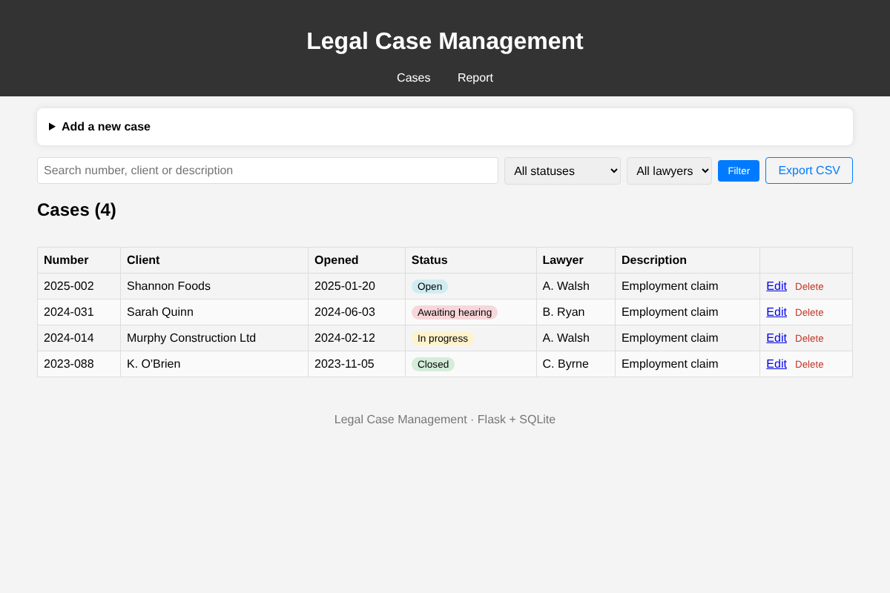
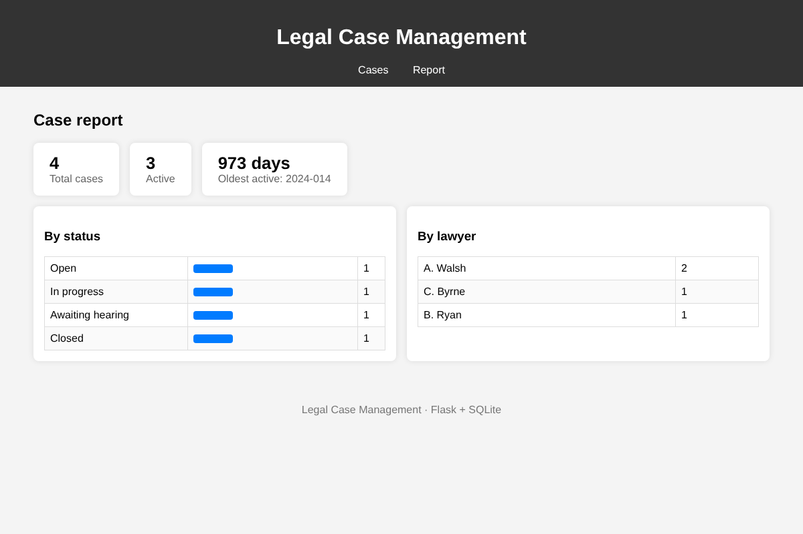

# Legal Case Management


A web app for a small law office to keep track of its cases: who the client is, which lawyer is responsible, the case status, and how long each case has been open. It's built with **Python, Flask and SQLite**.



## Features

- Add, edit and delete cases, with confirmation before deleting
- Validation: required fields, unique case number, valid opening date (not in the future)
- Search by number, client or description, and filter by status or lawyer
- Colour-coded status badges (Open, In progress, Awaiting hearing, Closed)
- Report page: totals, active cases, the oldest active case, and counts by status and by lawyer
- CSV export of the current list (filters are applied)
- The same report from the command line: `python reports.py`
- 12 unit and integration tests on GitHub Actions



## How it's organised

| File | What it does |
|---|---|
| `app.py` | Flask routes (app factory, so tests can use a temporary database) |
| `models.py` | `Case` dataclass and form validation |
| `database.py` | `CaseRepository`: all SQL, using parameterised queries |
| `reports.py` | Summary figures and CSV export |
| `templates/` | Jinja templates, with one form partial for both add and edit |

## Running locally

```bash
python -m venv .venv
source .venv/bin/activate      # Windows: .venv\Scripts\activate
pip install -r requirements.txt
python app.py                  # http://127.0.0.1:5000
```

| Variable | Default |
|---|---|
| `DATABASE` | `cases.db` (created automatically) |
| `SECRET_KEY` | dev value, so set a real one in production |
| `FLASK_DEBUG` | off; set to `1` for debug mode |

## Tests

```bash
python -m unittest discover -s tests -t . -v
```

## Ideas for next steps

- User login with roles (partner and associate)
- Deadlines and hearing dates with reminders
- Upload documents to a case
